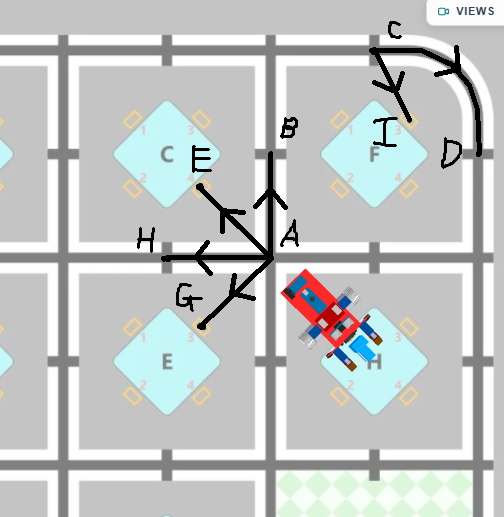

# ***Love4ever***

## hướng dẫn dùng Leanbot cho AIROC:

* ### Các code tham khảo, tìm trong folder /CodeTri/

* #### Lưu ý về các hàm rẽ:
* nếu muốn rẽ 1 góc 90 độ, hãy set 90
* nếu muốn rẽ góc lớn hơn, hãy nhân lên rồi thêm "1 tí" đơn vị vào (trong lúc thi sẽ cân chỉnh cho hoàn hảo) PS: hoặc ko cx đc :))

* #### Lưu ý về hàm dò line:
* dò line này sẽ dò theo khoảng cách nên đi sẽ chuẩn hơn, muốn đi 1 đoạn hãy set 150, rẽ bao nhiêu thì set bấy nhiêu nhân lên.
* đoạn cong ở góc bản đồ có giá trị 300

* #### lưu ý về việc gắp khối:
* khi muốn đi đến vị trí gắp khối, nếu phải rẽ và quệt vào khối, hãy chỉnh distance nhỏ hơn 1 chút để robot rẽ tốt hơn.

* # Cụ thể về các góc và khoảng cách để dùng:

* muốn đi từ A đến B: hãy set distance = 150, muốn đi khoảng nhiều hơn set lớn hơn.
* muốn đi từ A đến E, hãy set rẽ 1 góc 40 độ và đi 7cm.
* muốn đi từ A đến H, hãy set rẽ 1 góc 90 độ và distance = 150.
* muốn đi từ A đến G, hãy set rẽ 1 góc 140 độ và đi 7cm.
* muốn đi từ C đến D, hãy set distance = 300.
* muốn đi từ C đến I, hãy set rẽ 1 góc 55 độ và đi 4cm.

